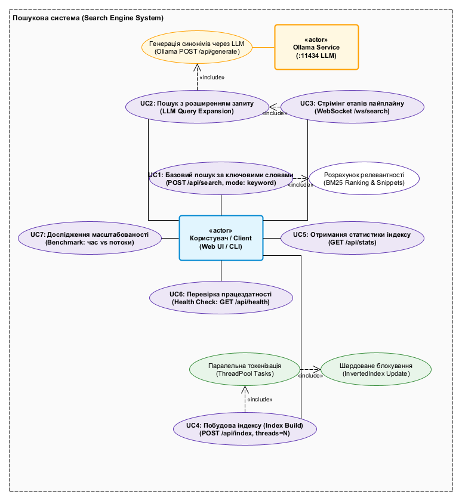

# Parallel Search Engine with LLM Query Expansion (C++20 & Web UI)

> **Курсова робота з дисципліни:** «Паралельні обчислення»  
> **Спеціальність:** 122 Комп’ютерні науки | НН ІПСА, КПІ ім. Ігоря Сікорського

Високопродуктивна контейнеризована пошукова система на **C++20** із власною реалізацією багатопотокового пулу потоків (**ThreadPool**), повністю самостійно реалізованим поверх динамічних масивів (`std::vector`) шардованим інвертованим індексом (**InvertedIndex** з `StringHashMap` на основі FNV-1a та ранжуванням BM25), інтеграцією з локальною нейромережею **Ollama** для розширення запитів (Query Expansion), підтримкою **REST API**, **WebSocket стрімінгу**, автономним веб-інтерфейсом (**Web UI**) та **CLI-клієнтом**.

---

## 🚀 Основні можливості

- **Паралельна побудова індексу:** Багатопотокова обробка текстових файлів через власний `ThreadPool` з регулюванням кількості потоків (параметр `threads` у `POST /api/index`).
- **Власна паралельна структура даних (без `std::unordered_map`):** Шардована хеш-таблиця `StringHashMap` поверх масивів `std::vector` (64 незалежні шарди з `std::shared_mutex`, вирішення колізій методом ланцюжків, хеш FNV-1a та динамічне рехешування).
- **BM25 Ранжування:** Алгоритм оцінки релевантності BM25 поверх власного масиву оцінок із кешованими в пам'яті прев'ю-сніпетами.
- **LLM Query Expansion (Ollama):** Автоматичне семантичне розширення запитів синонімами через `POST /api/generate` із синхронізованою чергою звернень.
- **WebSocket Streaming:** Стрімінг етапів виконання запиту в реальному часі (`query_expansion` $\to$ `keyword_search` $\to$ `done`).
- **Автономний Web UI та CLI-клієнт:** Візуалізація стрімінгу етапів у браузері та консольна утиліта `search` на C++.
- **Docker Compose:** Повний запуск системи зі свіжого клону репозиторію однією командою `docker compose up`.

---

## 📦 Швидкий старт (Docker Compose)

### 1. Запуск всієї системи зі свіжого клону
```bash
git clone https://github.com/nothome2005/PO_cursova_maslov.git
cd PO_cursova_maslov
docker compose up --build
```

Після запуску:
- **Web UI:** [http://localhost:8088](http://localhost:8088)
- **REST & WebSocket API:** `http://localhost:8088`
- **Ollama LLM (окремий сервіс):** `http://localhost:11434` (модель `llama3.2:1b` завантажується автоматично сервісом `ollama-init` у `./models/ollama`).
- **Портативність:** конфігурація працює як на CPU, так і на GPU без ручних кроків чи обов'язкового NVIDIA Container Toolkit.

---

## 📂 Шлях до датасету та його формат

- **Шлях до датасету:** `./data/documents` (монтується в контейнер за шляхом `/app/data/documents` через змінну середовища `DATA_DIR`).
- **Формат файлів:** набір текстових файлів із розширенням `.txt` англійською мовою у кодуванні **UTF-8 / ASCII** (звичайний неструктурований текст, рекурсивне сканування вкладених папок; приховані файли на зразок `.gitkeep` пропускаються).
- **Початковий запуск:** у репозиторії вже містяться контрольні документи в `./data/documents/*.txt`, тому `docker compose up` працює одразу після клонування.
- **Завантаження повного корпусу ($\ge 10\,000$ файлів, $\ge 2\text{ ГБ}$) із DeepMind Gutenberg:**
  ```bash
  python scripts/download_gutenberg.py --limit 10500 --threads 24 --dest data/documents/gutenberg
  ```
  *(Альтернативно: `python scripts/unpack_data.py` для розпакування локального архіву `D1.7GB.zip` або генерації базових текстів).*

---

## 💻 Використання CLI-клієнта

Консольний застосунок `search` збирається в `/app/search` усередині контейнера `search_engine_server` (або у `build/cli/search` при локальній збірці CMake).

```bash
# Перегляд довідки
docker exec search_engine_server /app/search --help

# Базовий пошук за ключовими словами (mode: keyword)
docker exec search_engine_server /app/search "parallel computing algorithms"

# Пошук із семантичним розширенням через LLM (mode: llm)
docker exec search_engine_server /app/search -m llm "ocean voyage ship"

# Перебудова індексу з використанням 8 потоків
docker exec search_engine_server /app/search -i 8

# Перегляд статистики індексу
docker exec search_engine_server /app/search --stats

# Вказати власну адресу сервера
./search -s localhost:8088 "space telescope"
```

Прапори CLI:
- `-h, --help` — довідка.
- `-s, --server <host:port>` — адреса сервера (за замовчуванням `localhost:8088`).
- `-m, --mode <mode>` — режим пошуку: `keyword` (за замовчуванням) або `llm`.
- `-i, --index <threads>` — перебудувати індекс на `N` потоках (`POST /api/index`).
- `--stats` — показати статистику індексу (`GET /api/stats`).

---

## 📡 Специфікація API (шляхи, поля та типи)

### 1. Health Check — `GET /api/health`
- **Запит:** без тіла (`—`).
- **Відповідь (`200 OK`, `application/json`):**

| Поле | Тип | Опис |
| :--- | :--- | :--- |
| `status` | `string` | Стан HTTP-сервера (`"ok"`). |
| `ollama` | `boolean` | Доступність сервісу Ollama (`true` або `false`). |

```json
{
  "status": "ok",
  "ollama": true
}
```

### 2. Побудова індексу (паралельно) — `POST /api/index`
- **Тіло запиту (`application/json`):**

| Поле | Тип | Опис |
| :--- | :--- | :--- |
| `threads` | `integer` | Кількість потоків `ThreadPool` (за замовчуванням `4`). |

- **Відповідь (`200 OK`, `application/json`):**

| Поле | Тип | Опис |
| :--- | :--- | :--- |
| `status` | `string` | Статус виконання (`"ok"`). |
| `documents_indexed` | `integer` | Кількість проіндексованих документів. |
| `time_ms` | `integer` | Час побудови індексу в мілісекундах. |

```json
// Request
{ "threads": 8 }

// Response
{
  "status": "ok",
  "documents_indexed": 10410,
  "time_ms": 39161
}
```

### 3. Пошук — `POST /api/search`
- **Тіло запиту (`application/json`):**

| Поле | Тип | Опис |
| :--- | :--- | :--- |
| `query` | `string` | Пошуковий запит користувача. |
| `mode` | `string` | Режим пошуку: `"keyword"` (за ключовими словами) або `"llm"` (з розширенням через Ollama). |

- **Відповідь (`200 OK`, `application/json`):**

| Поле | Тип | Опис |
| :--- | :--- | :--- |
| `results` | `array<object>` | Список релевантних документів (до 20 результатів). |
| `results[].doc_id` | `string` | Назва знайденого файлу документа. |
| `results[].score` | `number` | Нормалізована оцінка релевантності BM25 (`0.01`..`1.00`). |
| `results[].snippet` | `string` | Текстове прев'ю документа. |
| `time_ms` | `integer` | Час пошуку в індексі в мілісекундах. |
| `expanded_terms` | `array<string>` | Список термів, за якими виконано пошук (для `"llm"` містить синоніми від Ollama). |

```json
// Request
{
  "query": "space telescope",
  "mode": "keyword"
}

// Response
{
  "results": [
    {
      "doc_id": "train_28434.txt",
      "score": 1.0,
      "snippet": "Produced by David Edwards, Nigel Blower and the Online Distributed Proofreading Team..."
    }
  ],
  "time_ms": 1,
  "expanded_terms": ["space", "telescope"]
}
```

### 4. Статистика індексу — `GET /api/stats`
- **Запит:** без тіла (`—`).
- **Відповідь (`200 OK`, `application/json`):**

| Поле | Тип | Опис |
| :--- | :--- | :--- |
| `documents` | `integer` | Поточна кількість документів в індексі. |
| `index_build_time_ms` | `integer` | Тривалість останньої побудови індексу (мс). |
| `threads_used` | `integer` | Кількість потоків останньої побудови індексу. |

```json
{
  "documents": 10410,
  "index_build_time_ms": 39161,
  "threads_used": 8
}
```

### 5. WebSocket Стрімінг — `WS /ws/search`
- **Повідомлення клієнта (JSON):**

| Поле | Тип | Опис |
| :--- | :--- | :--- |
| `query` | `string` | Текст пошукового запиту. |

```json
{ "query": "space telescope" }
```

- **Послідовні повідомлення сервера (JSON):**
  1. Етап розширення запиту (`stage: "query_expansion"`):
     - `stage` (`string`): `"query_expansion"`
     - `data.original` (`string`): початковий запит
     - `data.expanded_terms` (`array<string>`): масив термів (базові слова + синоніми від LLM)
  2. Етап пошуку по індексу (`stage: "keyword_search"`):
     - `stage` (`string`): `"keyword_search"`
     - `data.results` (`array<object>`): масив `{ doc_id: string, score: number, snippet: string }`
     - `data.time_ms` (`integer`): час пошуку в мс
  3. Етап завершення (`stage: "done"`):
     - `stage` (`string`): `"done"`

```json
{"stage": "query_expansion", "data": {"original": "space telescope", "expanded_terms": ["space", "telescope", "astronomy", "spacecraft", "orbit"]}}
{"stage": "keyword_search", "data": {"results": [{"doc_id": "train_28434.txt", "score": 1.0, "snippet": "..."}], "time_ms": 1}}
{"stage": "done"}
```

---

## 📊 Дослідження масштабованості (Scalability Benchmark)

Для автоматизованого зняття показників, побудови графіків (`graphics/png/benchmark_indexing.png`, `graphics/png/benchmark_throughput.png`) та дослідження закону Амдала запустіть:
```bash
python scripts/benchmark.py
```
Результати зберігаються у файлі `benchmark_results.json` та містять:
- Час побудови індексу залежно від кількості потоків $T(p)$ ($p \in [1, 2, 4, 8, 12, 16]$).
- Прискорення $S(p) = \frac{T(1)}{T(p)}$ та ефективність $E(p) = \frac{S(p)}{p} \times 100\%$.
- Пропускну здатність Throughput (запитів/сек) під навантаженням одночасних клієнтів ($1..50$).

---

## 📐 UML-Діаграми

### 1. Use Case Diagram


### 2. Class Diagram


### 3. Sequence Diagram


### 4. Deployment Diagram


Вихідні файли PlantUML розміщені в папці `docs/uml/`:
- `use_case.puml`
- `class_diagram.puml`
- `sequence_diagram.puml`
- `deployment_diagram.puml`

---

## 📚 Матеріали до захисту курсової роботи

- Пояснювальна записка: [`docs/Курсова_робота_ПО_Маслов.pdf`](docs/Курсова_робота_ПО_Маслов.pdf) (та `.docx`)
- Текст доповіді та сценарний план для відеозахисту: [`docs/defense_speech.md`](docs/defense_speech.md)
- Детально прокоментований код для розбору: [`docs/commented_code/`](docs/commented_code/)
- Відповіді на теоретичні питання (Додаток Б): [`docs/theoretical_answers.md`](docs/theoretical_answers.md)
