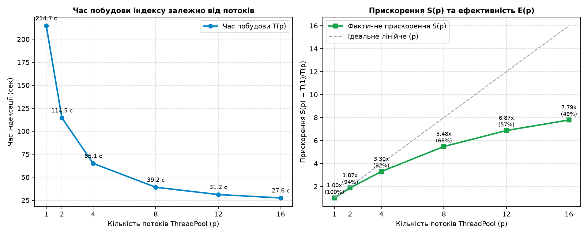
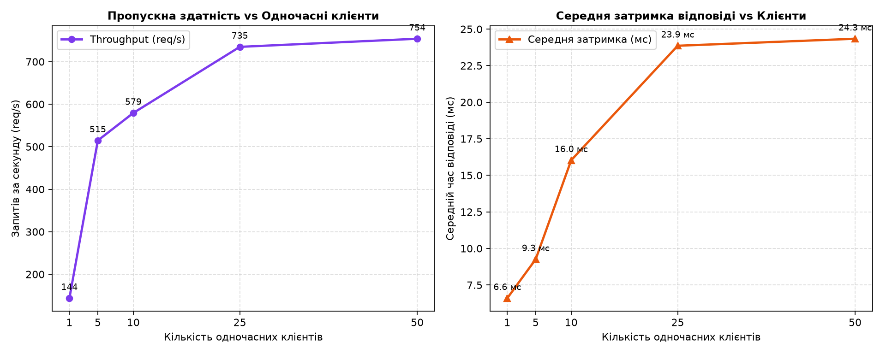
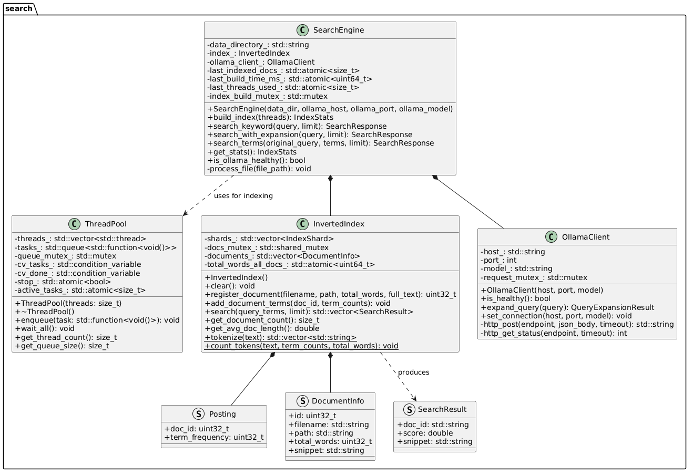
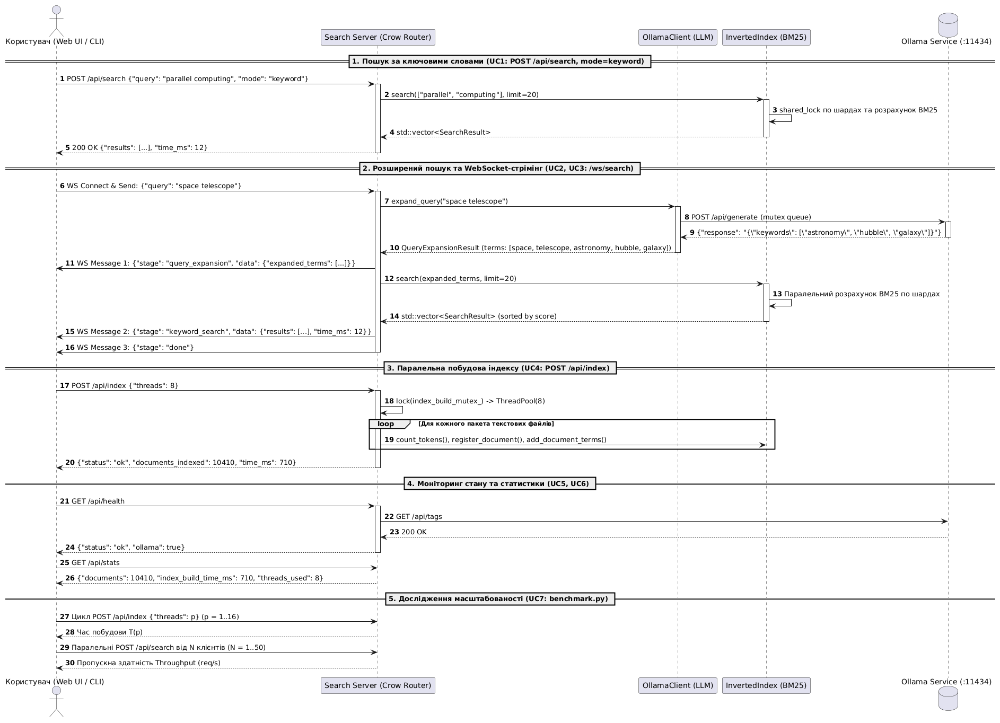
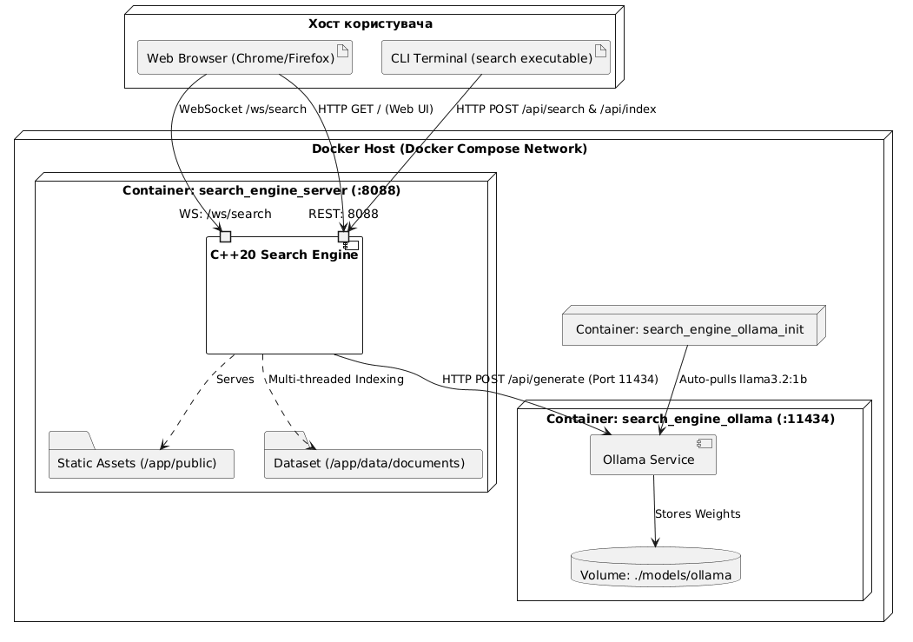

# Паралельна пошукова система з інтеграцією LLM

> **Курсова робота з дисципліни:** «Паралельні обчислення»  
> **Навчальний підрозділ:** НН ІПСА, КПІ ім. Ігоря Сікорського  
> **Виконав:** Маслов Андрій, група КН-31  

Контейнеризована багатопотокова повнотекстова пошукова система на **C++20** із власним пулом потоків (`ThreadPool`), самостійно реалізованим поверх динамічних масивів (`std::vector`) шардованим інвертованим індексом (`InvertedIndex` та `StringHashMap<V>`), ранжуванням **BM25**, локальною великою мовною моделлю **Ollama (`llama3.2:1b`)** для семантичного розширення запитів, **REST API**, триетапним **WebSocket**-стрімінгом, автономним **Web UI** та консольним **CLI-клієнтом**.

---

## Зміст

1. [Архітектурні особливості та технології](#архітектурні-особливості-та-технології)
2. [Запуск системи (Docker Compose)](#запуск-системи-docker-compose)
3. [Шлях до датасету та його формат](#шлях-до-датасету-та-його-формат)
4. [Використання CLI-клієнта](#використання-cli-клієнта)
5. [Специфікація API та WebSocket](#специфікація-api-та-websocket)
6. [Дослідження масштабованості (Benchmark)](#дослідження-масштабованості-benchmark)
7. [UML-діаграми та структура проєкту](#uml-діаграми-та-структура-проєкту)

---

## Архітектурні особливості та технології

| Компонент | Технологія / Реалізація | Призначення |
| :--- | :--- | :--- |
| Мова ядра та збірка | C++20 (`g++`), CMake, Ninja | Високопродуктивна багатопотокова обробка без збирача сміття |
| Пул потоків | Власний `ThreadPool` (`std::thread`, `std::mutex`, `std::condition_variable`, `std::atomic`) | Паралельна індексація документів пакетами |
| Структура даних індексу | Власна `StringHashMap<V>` поверх `std::vector` (FNV-1a, ланцюжки, рехешування при > 0.75) та `InvertedIndex` на 64 шардах (`std::shared_mutex`) | Потокобезпечний запис пакетами по шардах і конкурентне читання (без `std::unordered_map` / `std::unordered_set`) |
| Фільтрація та ранжування | Відсортований `std::vector<std::string>` + `std::binary_search`, плаский масив оцінок **BM25** (`k1 = 1.2`, `b = 0.75`) | Швидке відсіювання стоп-слів, обчислення релевантності та видача кешованих сніпетів |
| Семантичне розширення запитів | Ollama (`llama3.2:1b`), `cpp-httplib` | Окремий сервіс LLM для підбору ключових слів-синонімів із чергою (`request_mutex_`) та graceful fallback |
| HTTP / WebSocket сервер | Crow C++ (v1.2.0), Asio, `nlohmann/json` | Обслуговування REST API, `WS /ws/search` та роздача Web UI на порту `8088` |
| Клієнтські інтерфейси | Web UI (`public/index.html`) та C++ CLI (`cli/src/main.cpp`) | Пошук, перегляд статистики, керування потоками індексації, візуалізація WebSocket-етапів |
| Контейнеризація | Docker, Docker Compose | Оркестрація сервісів `search-engine`, `ollama` та `ollama-init` |

---

## Запуск системи (Docker Compose)

Система розгортається зі свіжого клону репозиторію однією командою без ручних налаштувань. Сервіс Ollama працює в окремому контейнері, а службовий контейнер `ollama-init` автоматично завантажує модель `llama3.2:1b` під час першого запуску.

```bash
git clone https://github.com/nothome2005/PO_cursova_maslov.git
cd PO_cursova_maslov
docker compose up --build
```

Для запуску у фоновому режимі використовуйте прапор `-d` (`docker compose up -d --build`). Додатково у корені репозиторію наявні допоміжні скрипти `start.ps1` та `start.bat`.

Після запуску доступні такі адреси:
- **Web UI:** `http://localhost:8088`
- **REST API та WebSocket:** `http://localhost:8088`
- **Ollama API (окремий сервіс):** `http://localhost:11434` (ваги моделі зберігаються у `./models/ollama`)

---

## Шлях до датасету та його формат

- **Шлях до датасету:** `./data/documents` (монтується в контейнер `search_engine_server` за шляхом `/app/data/documents` через змінну середовища `DATA_DIR`).
- **Формат файлів:** неструктуровані текстові файли з розширенням `.txt` англійською мовою у кодуванні **UTF-8 / ASCII**. Індексатор рекурсивно обходить усі вкладені директорії всередині `DATA_DIR` та ігнорує службові/приховані файли (зокрема `.gitkeep`).
- **Стартовий корпус:** у репозиторії вже містяться чотири базові текстові документи в `./data/documents/*.txt`, тому пошук працює одразу після клонування і запуску `docker compose up`.
- **Повний експериментальний корпус (>= 10 000 документів, 3.72 ГБ):** завантажується з публічного сховища **DeepMind Gutenberg** (`gs://deepmind-gutenberg`) у підкаталог `data/documents/gutenberg` скриптом:

```bash
python scripts/download_gutenberg.py --limit 10500 --threads 24 --dest data/documents/gutenberg
```

Альтернативно для розпакування локального архіву або генерації тестових документів передбачено скрипт `scripts/unpack_data.py`. Великі каталоги корпусу виключено з Git через `.gitignore`.

---

## Використання CLI-клієнта

Консольний клієнт `search` компілюється у `/app/search` усередині контейнера `search_engine_server` (або в `build/cli/search` при локальному складанні через CMake).

### Параметри командного рядка

| Прапор | Аргумент | Опис |
| :--- | :--- | :--- |
| `-h`, `--help` | `—` | Вивести довідку щодо використання утиліти |
| `-s`, `--server` | `<host:port>` | Адреса сервера пошуку (за замовчуванням `localhost:8088`) |
| `-m`, `--mode` | `<keyword \| llm>` | Режим пошуку: `keyword` (за замовчуванням) або `llm` |
| `-i`, `--index` | `[threads]` | Запустити перебудову індексу на вказаній кількості потоків (за замовчуванням `4`) |
| `--stats` | `—` | Отримати та вивести поточну статистику індексу |

### Приклади викликів

```bash
# Виведення довідки
docker exec search_engine_server /app/search --help

# Отримання поточної статистики індексу
docker exec search_engine_server /app/search --stats

# Пошук за ключовими словами (режим keyword)
docker exec search_engine_server /app/search "parallel computing"

# Пошук із семантичним розширенням через LLM (режим llm)
docker exec search_engine_server /app/search -m llm "ocean voyage ship"

# Перебудова індексу з використанням 8 потоків
docker exec search_engine_server /app/search -i 8

# Локальний запуск клієнта із зазначенням адреси сервера
./search -s localhost:8088 "space telescope"
```

---

## Специфікація API та WebSocket

Сервер надає фіксований HTTP/JSON REST API та WebSocket-інтерфейс на порту `8088` із підтримкою CORS (`Access-Control-Allow-Origin: *`).

### 1. Перевірка стану сервісів — `GET /api/health`

- **Тіло запиту:** відсутнє.
- **Відповідь (`200 OK`, `application/json`):**

| Поле | Тип | Опис |
| :--- | :--- | :--- |
| `status` | `string` | Стан HTTP-сервера (`"ok"`). Повертається одразу після запуску, початкова індексація виконується у фоновому потоці |
| `ollama` | `boolean` | Доступність контейнера Ollama (`true` або `false`) |

```json
{
  "status": "ok",
  "ollama": true
}
```

### 2. Паралельна перебудова індексу — `POST /api/index`

- **Тіло запиту (`application/json`):**

| Поле | Тип | Обов'язковість | Опис |
| :--- | :--- | :--- | :--- |
| `threads` | `integer` | Опціональне (за замовчуванням `4`) | Кількість потоків пулу `ThreadPool` для індексації |

- **Відповідь (`200 OK`, `application/json`):**

| Поле | Тип | Опис |
| :--- | :--- | :--- |
| `status` | `string` | Статус завершення операції (`"ok"`) |
| `documents_indexed` | `integer` | Загальна кількість проіндексованих файлів |
| `time_ms` | `integer` | Тривалість побудови індексу в мілісекундах |

```json
// Приклад запиту
{
  "threads": 8
}

// Приклад відповіді
{
  "status": "ok",
  "documents_indexed": 10410,
  "time_ms": 49802
}
```

### 3. Повнотекстовий пошук — `POST /api/search`

- **Тіло запиту (`application/json`):**

| Поле | Тип | Обов'язковість | Опис |
| :--- | :--- | :--- | :--- |
| `query` | `string` | Обов'язкове | Текстовий пошуковий запит |
| `mode` | `string` | Опціональне (за замовчуванням `"keyword"`) | Режим пошуку: `"keyword"` (прямий пошук) або `"llm"` (розширення запиту через Ollama) |

- **Відповідь (`200 OK`, `application/json`):**

| Поле | Тип | Опис |
| :--- | :--- | :--- |
| `results` | `array<object>` | Перелік знайдених документів (до 20 найрелевантніших записів) |
| `results[].doc_id` | `string` | Ім'я файлу документа |
| `results[].score` | `number` | Нормалізована оцінка релевантності BM25 у діапазоні `[0.00, 1.00]` |
| `results[].snippet` | `string` | Текстове прев'ю документа (кешоване в оперативній пам'яті) |
| `time_ms` | `integer` | Час виконання пошуку по інвертованому індексу в мілісекундах |
| `expanded_terms` | `array<string>` | Перелік термів, за якими здійснювався пошук |

- **Відповідь при помилці парсингу (`400 Bad Request`, `application/json`):**

| Поле | Тип | Опис |
| :--- | :--- | :--- |
| `error` | `string` | Опис помилки (наприклад, `"Invalid JSON"`) |

```json
// Приклад запиту
{
  "query": "space telescope",
  "mode": "keyword"
}

// Приклад відповіді
{
  "results": [
    {
      "doc_id": "train_28434.txt",
      "score": 1.0,
      "snippet": "Produced by David Edwards, Nigel Blower and the Online Distributed Proofreading Team..."
    }
  ],
  "time_ms": 1,
  "expanded_terms": ["space", "telescope"]
}
```

### 4. Статистика індексу — `GET /api/stats`

- **Тіло запиту:** відсутнє.
- **Відповідь (`200 OK`, `application/json`):**

| Поле | Тип | Опис |
| :--- | :--- | :--- |
| `documents` | `integer` | Кількість документів у поточному індексі |
| `index_build_time_ms` | `integer` | Час останньої побудови індексу в мілісекундах |
| `threads_used` | `integer` | Кількість потоків, використаних під час останньої побудови |

```json
{
  "documents": 10410,
  "index_build_time_ms": 49802,
  "threads_used": 8
}
```

### 5. WebSocket-стрімінг етапів пошуку — `WS /ws/search`

- **Вхідне повідомлення від клієнта (`text frame`, JSON або plain text fallback):**

| Поле | Тип | Опис |
| :--- | :--- | :--- |
| `query` | `string` | Пошуковий запит користувача |

```json
{
  "query": "space telescope"
}
```

- **Вихідні повідомлення від сервера (послідовно 3 JSON-повідомлення):**

1. **Етап 1 (`stage: "query_expansion"`):**

| Поле | Тип | Опис |
| :--- | :--- | :--- |
| `stage` | `string` | Фіксоване значення `"query_expansion"` |
| `data` | `object` | Об'єкт результату розширення запиту |
| `data.original` | `string` | Вихідний запит користувача |
| `data.expanded_terms` | `array<string>` | Токенізовані базові терми та синоніми, згенеровані Ollama |

2. **Етап 2 (`stage: "keyword_search"`):**

| Поле | Тип | Опис |
| :--- | :--- | :--- |
| `stage` | `string` | Фіксоване значення `"keyword_search"` |
| `data` | `object` | Об'єкт результатів пошуку в індексі |
| `data.results` | `array<object>` | Масив документів `{ "doc_id": string, "score": number, "snippet": string }` |
| `data.time_ms` | `integer` | Час пошуку по індексу в мілісекундах |

3. **Етап 3 (`stage: "done"`):**

| Поле | Тип | Опис |
| :--- | :--- | :--- |
| `stage` | `string` | Фіксоване значення `"done"` (сигнал завершення пайплайну) |

```json
{"stage": "query_expansion", "data": {"original": "space telescope", "expanded_terms": ["space", "telescope", "astronomy", "spacecraft", "orbit"]}}
{"stage": "keyword_search", "data": {"results": [{"doc_id": "train_28434.txt", "score": 1.0, "snippet": "..."}], "time_ms": 1}}
{"stage": "done"}
```

---

## Дослідження масштабованості (Benchmark)

Для проведення експериментальних замірів масштабованості, розрахунку прискорення `S(p) = T(1) / T(p)`, ефективності `E(p) = (S(p) / p) * 100%` за законом Амдала, пропускної здатності та автоматичної побудови графіків (`graphics/png/benchmark_indexing.png`, `graphics/png/benchmark_throughput.png`) запустіть:

```bash
python scripts/benchmark.py
```

Результати замірів на корпусі **10 410 документів (3.72 ГБ)**:
- **Індексація:** скорочення часу з `243 178 мс` (1 потік) до `37 265 мс` (16 потоків), прискорення `6.53x`, ефективність `40.8%`, паралельна частка за законом Амдала `f ≈ 90.33%`.
- **Пропускна здатність читання (`POST /api/search`):** зростання зі `143.8 req/s` (1 клієнт, середня затримка `6.60 мс`) до `754.0 req/s` (50 одночасних клієнтів, середня затримка `24.34 мс`, 100% успішних відповідей).




---

## UML-діаграми та структура проєкту

### 1. Діаграма прецедентів (Use Case)


### 2. Діаграма класів (Class Diagram)


### 3. Діаграма послідовності (Sequence Diagram)


### 4. Діаграма розгортання (Deployment Diagram)


### Структура каталогу проєкту

```text
PO_cursova_maslov/
├── CMakeLists.txt
├── Dockerfile
├── docker-compose.yml
├── start.bat / start.ps1
├── cli/
│   ├── CMakeLists.txt
│   └── src/main.cpp
├── data/documents/               # Каталог текстового корпусу (DATA_DIR)
├── docs/
│   ├── Курсова_робота_ПО_Маслов.pdf
│   ├── Курсова_робота_ПО_Маслов.docx
│   └── uml/                      # Джерела PlantUML (.puml)
├── graphics/
│   ├── graphml/                  # Діаграми у форматі yEd GraphML
│   └── png/                      # Діаграми, графіки та скріншоти інтерфейсів
├── models/ollama/                # Сховище ваг локальної моделі Ollama
├── public/index.html             # Автономний Web UI
├── scripts/
│   ├── benchmark.py              # Навантажувальне тестування та графіки
│   ├── download_gutenberg.py     # Завантаження датасету DeepMind Gutenberg
│   └── unpack_data.py            # Допоміжний скрипт підготовки текстів
└── server/
    ├── CMakeLists.txt
    ├── include/                  # Заголовки (thread_pool, inverted_index, search_engine, ollama_client)
    └── src/                      # Реалізація C++20 сервера
```
